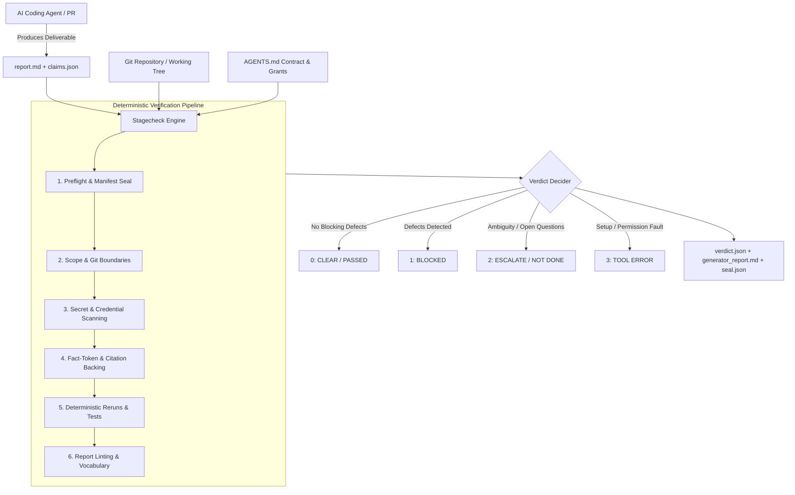
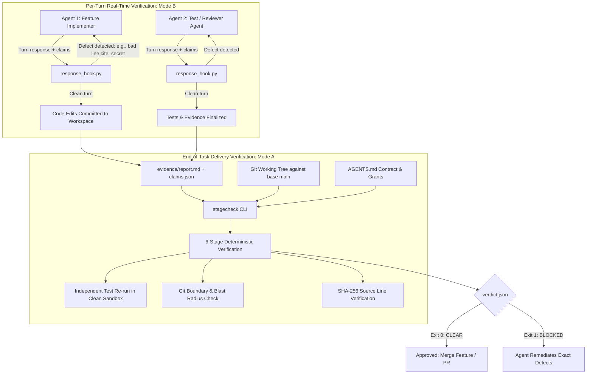

# Stagecheck 🛡️

**Deterministic Multi-Agent Verification & Assurance Engine for AI Coding Agents**

[](LICENSE)
[](https://www.python.org/)
[](bin/verify_production.sh)
[](MANIFEST.sha256)

---

## Welcome to Stagecheck! 👋

**Stagecheck** is an offline, tamper-evident quality and verification engine designed to audit deliverables produced by autonomous AI coding agents (such as Claude, Codex, or custom LLM pipelines).

Instead of relying on another probabilistic LLM to "grade" an agent's work, Stagecheck performs **deterministic, mechanical, byte-exact verification**:
- It inspects Git repositories, ASTs, and files directly.
- It verifies that every factual statement, citation, line number, and command output claimed by an AI agent is 100% backed by real files on disk.
- It catches hallucinations, out-of-bounds file modifications, leaked private keys, broken tests, and forged quotes before code is merged or accepted.
- It cryptographically seals verification records into immutable SHA-256 audit chains.

---

## Table of Contents

1. [How It Works](#how-it-works)
2. [5-Minute Quickstart](#5-minute-quickstart)
   - [Installation](#1-installation)
   - [Basic Usage](#2-basic-usage)
3. [Understanding the Core Inputs](#understanding-the-core-inputs)
   - [1. The Deliverable Report (`report.md`)](#1-the-deliverable-report-reportmd)
   - [2. The Claims Attachment (`claims.json`)](#2-the-claims-attachment-claimsjson)
   - [3. The Contract (`AGENTS.md`)](#3-the-contract-agentsmd)
4. [The Two Execution Modes](#the-two-execution-modes)
   - [Mode A: Delivery Mode (Code & PR Verification)](#mode-a-delivery-mode-code--pr-verification)
   - [Mode B: Response Mode (Real-Time Turn / Stop Hook)](#mode-b-response-mode-real-time-turn--stop-hook)
5. [The Verification Checks](#the-verification-checks)
6. [Standard Exit Codes](#standard-exit-codes)
7. [Running Tests & CI/CD Verification](#running-tests--cicd-verification)
8. [Configuration Guide](#configuration-guide)
9. [Architecture & Advanced Topics](#architecture--advanced-topics)

---

## How It Works

Stagecheck operates as a deterministic referee between the AI agent and the human project owner:





1. **Input Submission:** An AI agent completes a coding task and outputs its summary report (`report.md`) along with a structured machine-readable citation file (`claims.json`).
2. **Deterministic Inspection:** Stagecheck inspects the actual Git working tree, calculates exact file and line hashes, verifies that cited commands actually ran, and ensures no unapproved files were modified.
3. **Verdict Generation:** Stagecheck produces a signed, immutable `verdict.json` and a human-readable `generator_report.md` linked by a SHA-256 seal.

---

## 5-Minute Quickstart

### 1. Installation

Stagecheck is built with standard Python packaging (`pyproject.toml`) and has **zero external library dependencies** (standard library only).

```bash
# Clone the repository
git clone https://github.com/your-org/stagecheck.git
cd stagecheck

# Install directly in your active virtual environment
pip install .
```

Verify that the CLI is ready:
```bash
stagecheck --help
```

Or run via the standalone POSIX shell launcher:
```bash
./bin/stagecheck.sh --help
```

---

### 2. Basic Usage

Run Stagecheck against a task output:

```bash
stagecheck \
  --task TASK-001 \
  --repo /path/to/your/project \
  --base HEAD~1 \
  --report /path/to/report.md \
  --claims /path/to/claims.json
```

If you are inspecting an uncommitted working tree during development, add `--allow-dirty`:
```bash
stagecheck \
  --task TASK-001 \
  --repo /path/to/your/project \
  --base HEAD~1 \
  --allow-dirty \
  --report /path/to/report.md \
  --claims /path/to/claims.json
```

---

## Understanding the Core Inputs

### 1. The Deliverable Report (`report.md`)

When an agent finishes work, it writes a markdown report. To satisfy Stagecheck's contract, the report must begin with **three mandatory top-level headings**:

```markdown
NOT DONE: None (all requested criteria completed)
Full Blast Radius Check: Inspected modified packages and updated tests
Enforcement Self-Check: Checked citations and ran local test suite

## Summary of Changes
Implemented token resolution in `bin/common.py` to allow dynamic environment paths.

## Verification
Ran `python3 -m unittest` with 100% pass rate.
```

> [!TIP]
> Any factual path, line range, SHA-256 hash, or command cited in `report.md` must be registered in `claims.json`. If an agent claims a test passed or quotes code that does not exist on disk, Stagecheck rejects it.

---

### 2. The Claims Attachment (`claims.json`)

`claims.json` tells Stagecheck *where* the agent found its evidence. Here is a minimal valid example:

```json
{
  "task_id": "TASK-001",
  "iteration": 1,
  "contract_sha256": "4b6118d097c0f1606e1fd8615cfcba996767cb2bcda9b1ff5faab270ef1b979a",
  "record": "/path/to/project/evidence/record.json",
  "record_sha256": "e3b0c44298fc1c149afbf4c8996fb92427ae41e4649b934ca495991b7852b855",
  "claims": [
    {
      "id": "C-001",
      "kind": "observation",
      "text": "resolve_tokens successfully expands environment variables",
      "scope": "bin/common.py",
      "label": "SOURCE_PROVEN",
      "citations": [
        {
          "type": "document",
          "path": "/path/to/project/bin/common.py",
          "sha256": "ab1ddd1de423bc5389083ece3909e0645117c097fab3f811426304c1111f353a",
          "lines": [12, 18],
          "quote": "def resolve_tokens(value, tokens):",
          "approved": true
        }
      ],
      "blast_radius": []
    }
  ]
}
```

#### Valid Evidence Labels:
- `SOURCE_PROVEN`: Backed by an exact quote and line range in an approved source file.
- `TEST_PROVEN`: Backed by an executed test command recorded in the operation ledger.
- `RUNTIME_PROVEN`: Backed by live execution records.
- `INFERRED`: Analytical conclusion derived from proven facts.
- `NOT_APPLICABLE`: Explicitly exempted items.

---

### 3. The Contract (`AGENTS.md`)

Stagecheck verifies work against a project contract (typically `AGENTS.md` at the project root). The contract defines:
- Active repository roots and evidence output directories.
- Approved authority grants and allowed CLI commands.
- Excluded paths that agents must never read or modify.

---

## The Two Execution Modes

Stagecheck provides two distinct modes for different points in the development lifecycle:

### Mode A: Delivery Mode (Code & PR Verification)
Used when an agent finishes an entire task or submits a pull request.
- **Requires:** `--repo`, `--base`, `--task`, `--report`, `--claims`.
- **Validates:** Git commit boundaries, changed paths, full test reruns, and package blast radius.

```bash
stagecheck \
  --task FEATURE-LOGIN \
  --repo /home/user/project \
  --base main \
  --report /home/user/project/evidence/report.md \
  --claims /home/user/project/evidence/claims.json
```

### Mode B: Response Mode (Real-Time Turn / Stop Hook)
Used by developer tools, IDE extensions, or agent loops (e.g. Claude Code or Codex Stop hooks) to check intermediate messages before showing them to the user.
- **Requires:** `--response`, `--task`, `--report`, `--claims`.
- **Omits:** Git commit and product rerun requirements (checks facts, quotes, line numbers, and secrets offline in milliseconds).

```bash
stagecheck \
  --response \
  --task TURN-004 \
  --report /path/to/agent_reply.md \
  --claims /path/to/turn_claims.json
```

---

## The Verification Checks

Stagecheck runs 8 deterministic checks in a strict fail-closed pipeline:

| Check Module | Description | What It Catches |
| :--- | :--- | :--- |
| **`preflight`** | Verifies tool integrity and control descriptors | Tampered tool files, modified manifests, instruction mismatches |
| **`scope_paths`** | Enforces directory and repository boundaries | Path traversal, edits outside the allowed repository root |
| **`secrets`** | Scans for credentials and sensitive material | Committed private keys (`.pem`, `.key`), cloud secrets, tokens |
| **`citations`** | Byte-exact validation of all quoted evidence | Hallucinated quotes, incorrect line numbers, stale file hashes |
| **`authority`** | Validates execution against signed owner grants | Unauthorized command execution, untrusted network calls |
| **`rerun`** | Re-executes commands in isolated sandboxes | Broken unit tests, mismatched exit codes, altered test outputs |
| **`report_lint`** | Audits report formatting and vocabulary | Missing mandatory headers, unproven assertions |
| **`qual_naming`** | Enforces test naming standards | Tests that bypass naming conventions to evade test runners |

---

## Standard Exit Codes

Stagecheck follows POSIX standard exit conventions:

| Exit Code | Result | Meaning |
| :---: | :--- | :--- |
| **`0`** | **PASSED / CLEAR** | All checks ran and found **zero blocking defects**. |
| **`1`** | **BLOCKING DEFECTS** | One or more blocking defects detected (unapproved files, tampered hashes, failed tests). |
| **`2`** | **NOT DONE / REVIEW** | Open questions, missing prerequisites, or incomplete deliverables requiring human disposition. |
| **`3`** | **TOOL ERROR** | Setup error, invalid CLI flags, permission failure, or corrupted manifest. |

---

## Running Tests & CI/CD Verification

Stagecheck includes an automated end-to-end test suite containing **over 120 regression, edge, and red-team tests**.

### Run the Complete Production Verification Suite
```bash
./bin/verify_production.sh
```

This single command:
1. Verifies the cryptographic manifest (`sha256sum -c MANIFEST.sha256`).
2. Confirms zero machine-specific path leaks.
3. Runs response hook unit guards (`evals/test_response_guards.py`).
4. Executes the full 41-case response evaluation suite (`evals/test_response.py`).
5. Executes the 58-test Clopper-Pearson statistical quality engine (`evals/test_quality.py`).
6. Executes Git exotic boundary and VCS tests (`scratch/test_git_and_quality_edges.py`).
7. Executes live adversarial red-teaming tests (`scratch/test_live_red_team_codex.py`).
8. Validates concurrency and TOCTOU barrier tests (`scratch/test_concurrency_toctou.py`).
9. Verifies CLI entrypoints in clean sandbox subshells.

### Run Individual Test Suites
```bash
# Response hook evaluations
python3 evals/test_response.py

# Response unit guards
python3 evals/test_response_guards.py

# Quality engine & Clopper-Pearson bounds
python3 evals/test_quality.py

# Verify manifest checksums
sha256sum -c MANIFEST.sha256
```

---

## Configuration Guide

Configuration files are located in `config/` and use standard JSON:

- [`config/paths.json`](config/paths.json): Instruction copy paths and additional permitted read paths. Supports `${STAGECHECK_HOME}` and `${PROGRAMME_ROOT}` token expansion.
- [`config/commands.json`](config/commands.json): Whitelist of approved commands, arguments, environment variables, and execution grants.
- [`config/modes.json`](config/modes.json): Configures checks as `blocking` or `report_only`.
- [`config/depth.json`](config/depth.json): Mapping of changed file paths to evaluation depths (`docs`, `code`, or `sensitive`).
- [`config/quality_targets.json`](config/quality_targets.json): Statistical thresholds (e.g. 95% Clopper-Pearson confidence) for automated check promotion.
- [`config/response_hook.json`](config/response_hook.json): Settings for per-turn response hooks (timeouts, repair budgets, send-back limits).

---

## Architecture & Advanced Topics

### Tamper-Evident History & Seal Chains
Every execution of Stagecheck writes an immutable output directory:
```
evidence/stagecheck/TASK_ID/ATTEMPT_NUMBER/
  ├── run.json                  # Complete execution inputs and environment
  ├── repository_status.json    # Exact git status and branch/HEAD details
  ├── preflight.json            # Tool integrity results
  ├── citations.json            # Citation validation results
  ├── verdict.json              # Final verdict and defect inventory
  ├── generator_report.md       # Deterministically rendered report
  └── seal.json                 # SHA-256 seal linking report and verdict
```
Subsequent runs inspect the historical chain using file-locking (`fcntl`) to detect any retrospective alteration or deletion.

### Clopper-Pearson Exact Confidence Bounds
Stagecheck does not promote a check from informational (`report_only`) to blocking simply because it passed a few times. It uses the **one-sided exact binomial Clopper-Pearson lower confidence bound** at $\alpha = 0.05$ (95% confidence). Under default targets, a check must achieve **59 consecutive clean evaluations** without a single false block before earning blocking authority.

### In-Tree Hermetic Verifiers
Stagecheck packages its own canonical verification utilities in [`tools/`](tools/):
- [`tools/verify_manifest.py`](tools/verify_manifest.py): Verifies architecture and manifest checksums.
- [`tools/verify_state_chain.py`](tools/verify_state_chain.py): Audits state update sequences and historical transitions.
- [`tools/capture_sp1_evidence.py`](tools/capture_sp1_evidence.py): Retains execution snapshots for offline audit.

---

## License

This project is licensed under the [MIT License](LICENSE).
